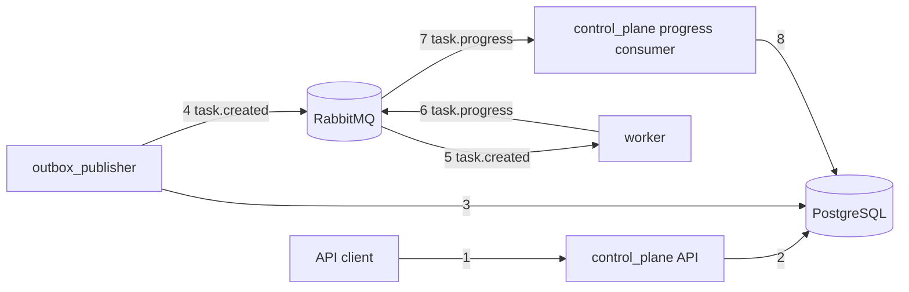

# Tenant Provisioning Control Plane

Containerized Python implementation of an asynchronous tenant provisioning control plane.

## Architecture



- `control_plane` serves the tenant and task HTTP APIs and applies worker progress updates.
- `outbox_publisher` publishes committed outbox events to RabbitMQ.
- `worker` consumes task events and simulates provisioning with configurable outcomes and delays.
- `shared` contains database models, broker/configuration helpers, timestamps, and state transitions.

PostgreSQL is the source of truth. Tenant mutations, tasks, and outbox events are committed
in one transaction; the publisher only sends committed events. RabbitMQ delivery is
at-least-once, so progress updates have stable idempotency keys and terminal task states
cannot regress. PostgreSQL optimistic locking protects concurrent API mutations across
processes. The worker is deliberately a simulator, not a production provisioning engine.

## Design decisions and trade-offs

- PostgreSQL is the source of truth for tenants, tasks, and outbox events to preserve transactional ordering and optimistic locking.
- RabbitMQ is used as the durable handoff between control plane and worker; the design assumes at-least-once delivery and makes handlers idempotent.
- The outbox pattern ensures task events are published only after a database transaction commits, avoiding the classic "publish-before-commit" bug.
- Worker simulations are intentionally lightweight; they consume task.created messages and emit deterministic progress updates with stable idempotency keys.


## Start and test

Requires Docker with the Compose plugin. From the repository root, start the complete
stack with the exact reviewer command:

```bash
make up
```

The API is at `http://localhost:8000` (`/health` is a liveness check), PostgreSQL is
available on port `5432`, RabbitMQ on `5672`, and its management UI on
`http://localhost:15672`. Compose starts the API, progress consumer, outbox publisher,
and worker as separate processes.

The exact full test command is:

```bash
make test
```

Other quality-gate commands:

```bash
make lint      # Ruff static checks
make format    # Apply Ruff formatting
make security  # Bandit scan of app/
```

`make down` stops the stack while preserving the PostgreSQL volume. `make up` also
preserves existing data; use Docker's explicit volume-removal options only when you
intend to erase local state.

## API examples

Create a tenant; the response contains its generated `id` and starts in `provisioning`:

```bash
curl -sS -X POST http://localhost:8000/tenants \
  -H 'Content-Type: application/json' \
  -d '{"slug":"acme","name":"Acme Labs"}'
```

Use the returned tenant UUID to observe the tenant and its task. `GET /tasks` and
`GET /tenants` return `{ "items": [...], "next_cursor": ... }`; list endpoints accept
`limit` (1–100) and numeric `cursor` parameters. Tasks can also be filtered by
`tenant_id`, `status`, and `type`; tenants can be filtered by `status`.

```bash
# Set this to the UUID returned by POST /tenants.
TENANT_ID=replace-with-tenant-uuid
curl -sS "http://localhost:8000/tenants/$TENANT_ID"
curl -sS "http://localhost:8000/tasks?tenant_id=$TENANT_ID"
```

Only update an `active` tenant, and pass the current `version` from its detail response.
Deploy completion increments a newly created tenant's version, so do not assume it is
still `1`. The update response is `updating`; completion returns it to `active`.

```bash
VERSION=replace-with-current-version
curl -sS -X PATCH "http://localhost:8000/tenants/$TENANT_ID" \
  -H 'Content-Type: application/json' \
  -d "{\"name\":\"Acme Labs Updated\",\"version\":$VERSION}"
```

Delete is allowed for `active` or `failed` tenants and also requires the current version.
The response is `202 Accepted` with status `destroying`; successful completion sets
`destroyed`.

```bash
curl -sS -X DELETE "http://localhost:8000/tenants/$TENANT_ID" \
  -H 'Content-Type: application/json' \
  -d "{\"version\":$VERSION}"
```

Domain errors use `{ "error": { "code", "message", "details" } }` (for example,
`tenant_version_conflict`); request validation errors use FastAPI's standard `422`
response.

## Observe task lifecycle

After creating a tenant, poll its detail and task list to see
`accepted → in_progress → done` and `provisioning → active`:

```bash
TENANT_ID=replace-with-tenant-uuid
curl -sS "http://localhost:8000/tenants/$TENANT_ID"
curl -sS "http://localhost:8000/tasks?tenant_id=$TENANT_ID"
```

The worker service defaults to `--fail-rate 0.0`, `--min-delay-ms 250`, and
`--max-delay-ms 750`. To run a deterministic failure scenario, stop the default worker
and start a configured one in a terminal:

```bash
docker compose stop worker
docker compose run --rm --no-deps worker \
  python -m app.worker.simulator --fail-rate 1.0 \
  --min-delay-ms 250 --max-delay-ms 750
```

While it is running, create a tenant in another terminal; its deploy task will fail and
the tenant will become `failed`. Stop the configured worker with Ctrl-C, then restore
the default worker with `docker compose up -d worker`.

## Duplicate and out-of-order progress demo

For deterministic manual testing, stop the worker first, create a tenant, then copy its
task UUID from `/tasks?tenant_id=<tenant-uuid>`. Publish messages from the host through
the API container; the script uses that container's `APP_RABBITMQ_URL`. Repeating the
same idempotency key sends the same logical update twice; only the first is applied:

```bash
TENANT_ID=replace-with-tenant-uuid
TASK_ID=replace-with-task-uuid
```
```bash
docker compose stop worker
docker compose run --rm --no-deps api python scripts/publish_progress.py \
  --task-id "$TASK_ID" --status in_progress --worker-id demo-worker \
  --idempotency-key duplicate-demo --repeat 2
```

Then publish a terminal result followed by a stale update with a different key. The task
will remain `done` and the tenant `active`:

```bash
docker compose run --rm --no-deps api python scripts/publish_progress.py \
  --task-id "$TASK_ID" --status done --worker-id demo-worker \
  --idempotency-key terminal-demo
docker compose run --rm --no-deps api python scripts/publish_progress.py \
  --task-id "$TASK_ID" --status in_progress --worker-id demo-worker \
  --idempotency-key stale-demo
curl -sS "http://localhost:8000/tenants/$TENANT_ID"
curl -sS "http://localhost:8000/tasks?tenant_id=$TENANT_ID"
```

Restore the default worker when finished: `docker compose up -d worker`.

## No secrets

Do not commit credentials, tokens, or other secrets. Compose uses local development
settings for this self-contained stack; use secret management rather than repository
files for any non-local deployment.
