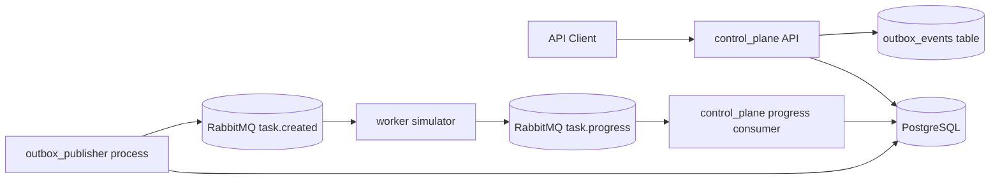

# Tenant Provisioning Control Plane Architecture

## Goal

Build one locally runnable system containing:

- A control-plane API for tenants and tasks.
- A control-plane worker-progress consumer that applies worker updates.
- A generic outbox publisher that delivers committed events to RabbitMQ.
- A worker simulator that consumes tasks and emits progress updates.
- Local infrastructure for persistence and messaging.

The priority is correctness around tenant/task state transitions, optimistic locking,
concurrent requests, and at-least-once messaging.

## Recommended Stack

- Language: Python 3.12
- API: FastAPI with Pydantic request/response schemas
- Database: PostgreSQL
- ORM/migrations: SQLAlchemy 2.x plus Alembic
- Broker: RabbitMQ
- Messaging client: aio-pika
- Tests: pytest, pytest-asyncio, httpx, testcontainers or Docker Compose test services
- Quality: ruff for lint/format, bandit for security scanning
- Runtime: Docker Compose

Python is chosen for speed of implementation and readable tests. PostgreSQL is chosen
because it provides real unique constraints, row-level concurrency semantics, and
transactional guarantees. RabbitMQ is chosen because it is easy to run locally, easy to
inspect, and naturally models the two queues needed by the assignment.

## Component Architecture

The codebase is organized by runtime/business component first, not by technology layer.
Each component owns one clear responsibility:

- `control_plane`: owns tenant/task HTTP behavior and worker-progress ingestion.
- `outbox_publisher`: owns reliable delivery of already-committed outbox rows.
- `worker`: owns provisioning simulation.
- `shared`: owns cross-process contracts and infrastructure helpers.

Runtime process boundaries:



Source dependency direction:

```text
app/control_plane      -> app/shared
app/control_plane      -> app/control_plane/repositories
app/outbox_publisher   -> app/shared
app/worker             -> app/shared
app/shared/state.py    -> standard library only
```

Important boundaries:

- The control plane creates outbox rows with complete event payloads.
- The outbox publisher is deliberately dumb: it reads unpublished rows and publishes the
  stored JSON payload. It should not know tenant business rules.
- The worker simulator does not call the control-plane API. It talks only through
  RabbitMQ.
- The worker-progress consumer belongs to the control plane because it interprets worker
  updates and mutates tenant/task state.

## Runtime Processes

Run these services under one Docker Compose command:

- `api`: FastAPI HTTP service from `app.control_plane.api.main`.
- `progress-consumer`: control-plane process that consumes worker progress messages.
- `outbox-publisher`: separate process that publishes committed outbox events.
- `worker`: simulator process with configurable delay and failure behavior.
- `postgres`: durable database.
- `rabbitmq`: broker with management UI enabled for debugging.

The Python services may share one Docker image. They remain separate runtime processes so
failure, logs, and responsibilities are clear.

## Domain Model

### Tenant

Fields:

- `id`: UUID, server-generated.
- `slug`: unique forever, 3-28 chars, matches `^[a-z][-a-z0-9]{1,26}[a-z0-9]$`.
- `name`: non-empty string.
- `status`: `provisioning`, `active`, `updating`, `destroying`, `destroyed`, `failed`.
- `version`: integer, starts at `1`, increments on every mutation.
- `created_at`: timestamp with milliseconds and `Z` suffix in API responses.
- `updated_at`: timestamp with milliseconds and `Z` suffix in API responses.

Slug uniqueness must include destroyed tenants. Implement this as a permanent unique
database constraint on `tenants.slug`.

### Task

Fields:

- `id`: UUID, server-generated, also the outbound event id.
- `type`: `deploy`, `update`, or `destroy`.
- `tenant_id`: UUID foreign key.
- `status`: `accepted`, `in_progress`, `done`, or `failed`.
- `created_at`: timestamp with milliseconds and `Z` suffix in API responses.
- `updated_at`: timestamp with milliseconds and `Z` suffix in API responses.

Tasks are created only by tenant mutations. Tasks are read-only over HTTP.

### Processed Worker Update

Persist worker progress update ids to make inbound message handling idempotent.

Fields:

- `idempotency_key`: unique string from the progress message.
- `task_id`: UUID.
- `received_at`: timestamp.

This table records that the control plane has already processed a logical worker update.
It protects against RabbitMQ redelivery, worker retry, and consumer crashes after a DB
commit but before broker acknowledgement.

### Outbox Event

Persist outbound task events in the same transaction that creates or updates the tenant.

Fields:

- `id`: UUID.
- `event_type`: for example `task.created`.
- `exchange`: RabbitMQ exchange.
- `routing_key`: RabbitMQ routing key.
- `payload`: JSON.
- `published_at`: nullable timestamp.
- `created_at`: timestamp.

The control plane writes the full payload. The outbox publisher only delivers it.
This avoids publishing before a transaction commits and makes publish retries safe.

## State Machines

### Task State Transitions

Allowed:

- `accepted -> in_progress`
- `in_progress -> done`
- `in_progress -> failed`

Order tolerance:

- Duplicate updates with the same idempotency key are ignored.
- Updates for terminal tasks are acknowledged and ignored.
- Stale transitions that would regress state are acknowledged and ignored.
- A direct `accepted -> done` or `accepted -> failed` progress update may be accepted
  to tolerate missing `in_progress`, but document this choice. If implemented, it must
  be covered by tests.

### Tenant State Transitions

API driven:

- `POST /tenants`: creates `provisioning` tenant and `deploy` task.
- `PATCH /tenants/{id}`: only allowed from `active`; moves tenant to `updating` and creates `update` task.
- `DELETE /tenants/{id}`: allowed from `active` or `failed`; moves tenant to `destroying` and creates `destroy` task.

Worker driven by the control-plane progress consumer:

- `deploy done`: `provisioning -> active`
- `update done`: `updating -> active`
- `destroy done`: `destroying -> destroyed`
- Any terminal failed task outcome: tenant becomes `failed`

Every tenant mutation increments `tenant.version`, including worker-applied task results.

## HTTP API

### Tenants

- `POST /tenants`
  - Body: `slug`, `name`
  - Response: `201 Created`
  - Creates tenant in `provisioning`, creates a `deploy` task, records an outbox event.

- `GET /tenants`
  - Query params: `limit`, `cursor`, optional `status`
  - Response: paginated list.

- `GET /tenants/{tenant_id}`
  - Response: tenant detail.

- `PATCH /tenants/{tenant_id}`
  - Body: `name`, `version`
  - Response: updated tenant.
  - Requires exact current version and tenant status `active`.
  - Moves tenant to `updating`, increments version, creates an `update` task.

- `DELETE /tenants/{tenant_id}`
  - Body or query: `version` recommended in body for consistency.
  - Response: `202 Accepted`.
  - Requires exact current version and tenant status `active` or `failed`.
  - Moves tenant to `destroying`, increments version, creates a `destroy` task.

### Tasks

- `GET /tasks`
  - Query params: `limit`, `cursor`, optional `tenant_id`, optional `status`, optional `type`.
  - Response: paginated list.

- `GET /tasks/{task_id}`
  - Response: task detail.

## Error Shape

Use a consistent machine-readable body:

```json
{
  "error": {
    "code": "tenant_version_conflict",
    "message": "Tenant version conflict.",
    "details": {
      "expected_version": 3,
      "actual_version": 4
    }
  }
}
```

Required error codes:

- `tenant_not_found`: `404`
- `tenant_already_exists`: `409`
- `tenant_update_not_allowed`: `409`
- `tenant_version_conflict`: `409`
- `task_not_found`: `404`

Validation errors may use FastAPI's default `422` shape or a custom compatible error
shape. Document whichever choice is implemented.

## Messaging

### Outbound Task Event

Exchange: `tenant-provisioning`

Routing key: `task.created`

Queue: `task.created`

Payload:

```json
{
  "id": "task-uuid",
  "event_type": "task.created",
  "occurred_at": "2026-10-12T10:30:00.000Z",
  "task": {
    "id": "task-uuid",
    "type": "deploy",
    "tenant_id": "tenant-uuid",
    "status": "accepted",
    "created_at": "2026-10-12T10:30:00.000Z",
    "updated_at": "2026-10-12T10:30:00.000Z"
  }
}
```

The control-plane request path never publishes directly. It writes the tenant, task, and
outbox event in one database transaction. The outbox publisher reads unpublished rows,
publishes the stored JSON payload to RabbitMQ, and marks rows published after broker
confirmation.

### Inbound Progress Event

Exchange: `tenant-provisioning`

Routing key: `task.progress`

Queue: `task.progress`

Payload:

```json
{
  "id": "stable-progress-update-id",
  "event_type": "task.progress",
  "occurred_at": "2026-10-12T10:30:03.000Z",
  "task_id": "task-uuid",
  "status": "in_progress",
  "worker_id": "worker-1"
}
```

The `id` is the idempotency key. The control-plane progress consumer stores it before
applying state changes in the same transaction, using a unique constraint to make
duplicate delivery safe.

## Concurrency Strategy

- Use unique database constraints for slug uniqueness.
- Use `version` in the `WHERE` clause for mutating tenant operations:
  `WHERE id = :id AND version = :version`.
- If the update affects zero rows, reload the tenant to distinguish not found from
  version conflict or invalid state.
- Keep tenant mutation, task creation, and outbox row creation in one transaction.
- Add tests that fire concurrent PATCH requests with the same version and assert exactly
  one success.

## Persistence Strategy

PostgreSQL is the source of truth. RabbitMQ messages may be redelivered; handlers must be
safe under at-least-once delivery. The outbox table lets the system recover from API,
publisher, or broker restarts without losing task-created events.

## Testing Strategy

Required test areas:

- Slug validation and permanent uniqueness.
- Tenant create, list, get, update, and delete happy paths.
- State guard failures and structured error codes.
- Optimistic locking conflict.
- Concurrent PATCH with same version: exactly one succeeds.
- Task list/get behavior.
- Outbox event creation only after committed API mutations.
- Outbox publisher publishes stored payloads without knowing tenant rules.
- Progress consumer idempotency for duplicate worker progress messages.
- Progress consumer order tolerance for stale terminal/task updates.
- Worker simulator emits `in_progress` and terminal updates with stable ids.

Prefer focused service-level tests for domain behavior, API tests for HTTP contracts, and
integration tests for the broker flow.

## Repository Layout

```text
.
├── app/
│   ├── control_plane/
│   │   ├── __init__.py
│   │   ├── api/
│   │   │   ├── __init__.py
│   │   │   ├── errors.py
│   │   │   ├── main.py
│   │   │   ├── schemas.py
│   │   │   ├── tasks.py
│   │   │   └── tenants.py
│   │   ├── application/
│   │   │   ├── __init__.py
│   │   │   ├── progress.py
│   │   │   ├── tasks.py
│   │   │   └── tenants.py
│   │   ├── consumers/
│   │   │   ├── __init__.py
│   │   │   └── worker_progress.py
│   │   └── repositories/
│   │       ├── __init__.py
│   │       ├── outbox.py
│   │       ├── processed_worker_updates.py
│   │       ├── tasks.py
│   │       └── tenants.py
│   ├── outbox_publisher/
│   │   ├── __init__.py
│   │   ├── publisher.py
│   │   └── repository.py
│   ├── worker/
│   │   ├── __init__.py
│   │   └── simulator.py
│   └── shared/
│       ├── __init__.py
│       ├── broker.py
│       ├── config.py
│       ├── db.py
│       ├── models.py
│       ├── state.py
│       └── time.py
├── migrations/
├── scripts/
│   ├── concurrency_check.py
│   └── publish_progress.py
├── tests/
├── docker-compose.yml
├── Dockerfile
├── Makefile
├── pyproject.toml
└── README.md
```

## Package Responsibilities

`app/control_plane/api`

- FastAPI routes, request/response schemas, and structured HTTP errors.
- Depends on control-plane application services and shared config/time helpers.

`app/control_plane/application`

- Use-case orchestration for tenant commands, task reads, and worker progress handling.
- Encapsulates business transactions so API routes and consumers stay thin.

`app/control_plane/consumers`

- RabbitMQ entrypoint for worker progress messages.
- Calls `application.progress` to apply idempotent state changes.

`app/control_plane/repositories`

- Database access for tenants, tasks, outbox writes, and processed worker updates.
- Owns optimistic locking SQL, uniqueness handling, and transaction helpers.

`app/outbox_publisher`

- Standalone process that reads unpublished outbox rows and publishes stored payloads.
- Depends on shared broker/db helpers and its own outbox-publisher repository.
- Does not construct task events from tenants or decide domain transitions.

`app/worker`

- Standalone worker simulator.
- Consumes `task.created` and publishes `task.progress`.
- Does not import control-plane API or repositories.

`app/shared`

- Cross-component contracts and infrastructure: SQLAlchemy models, state transition
  helpers, config, DB sessions, broker declarations, and timestamp formatting.
- `shared.state` should remain pure and easy to unit test.

## Operational Commands

Document these final commands in the README:

```bash
make up
make test
make lint
make format
make security
```

`make up` should be the single cold-start command that builds and boots all local
dependencies and application processes.

## Key Trade-Offs

- Component-oriented layout mirrors the runtime architecture and interview discussion
  better than a technology-only layout.
- Shared models and infrastructure reduce duplication, but `shared` must stay small and
  contract-focused.
- The outbox publisher is separate from the control plane at runtime and in source
  layout, but the control plane still owns event creation.
- The outbox pattern is more code than direct publishing, but it directly addresses the
  assignment's durable commit-before-publish requirement.
- RabbitMQ does not provide exactly-once delivery; the design accepts at-least-once
  delivery and makes message handlers idempotent.
- PostgreSQL optimistic locking is preferred over in-memory locks because it remains
  correct across multiple API processes.
